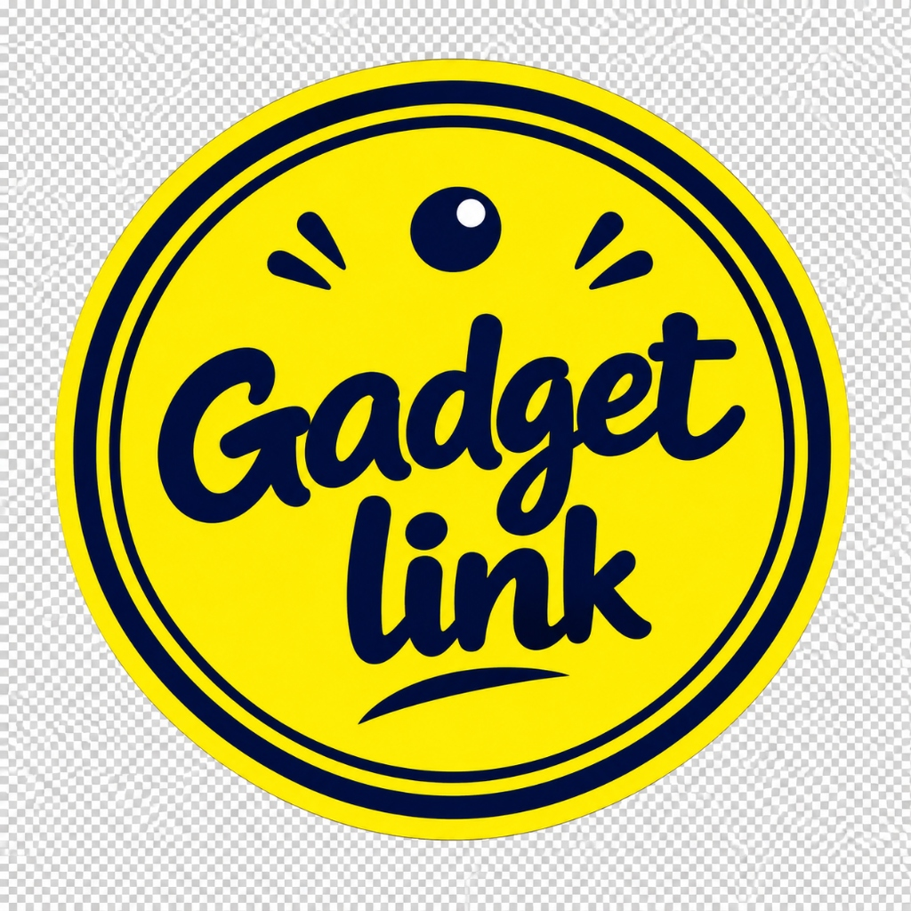

# Adam Gadget Link 📱⚡

> Premier Online Smartphone & Tech Destination. Authentic Apple iPhones, Samsung Galaxy, Google Pixel, and Flagship Accessories.



## ✨ Features

- **Responsive Mobile & Desktop Design**: Specially optimized layout with smooth navigation, mobile bottom navigation bar, and clean desktop header.
- **Brand Identity**: Styled with Solar Yellow (`#FFCC00`) & Deep Navy Slate (`#0B132B`) matching the official brand logo.
- **Offline & Local Asset Delivery**: All 15 product and flagship showcase photos are bundled locally in `assets/` for 0ms load times and 100% reliability.
- **Interactive Smartphone Catalog**:
  - Live real-time search by phone model, brand, chipset, or storage.
  - Category filters (*Apple, Samsung, Google, Xiaomi, Accessories*).
  - Sort by price, rating, and featured status.
  - Storage size selectors with dynamic price updates.
  - Color swatches for each smartphone.
- **Quick View Tech Spec Modal**: Complete hardware breakdown (Display, Processor, Cameras, Battery, RAM, OS).
- **Side-by-Side Phone Comparison Tool**: Compare two smartphones side-by-side with highlight specs.
- **Slide-out Cart & Checkout Drawer**:
  - Quantity controls, promo code support (`ADAM10` for 10% off), and subtotal calculation.
  - Direct WhatsApp order generator pre-filling customer details and item selections.
- **Saved Wishlist**: Persistent favorites saved locally.

## 🚀 Getting Started

Simply open `index.html` in any modern web browser:
```bash
# Clone the repository
git clone https://github.com/Canan-dev/Adam.git

# Open index.html in your browser
```

## 🛠️ Built With

- **HTML5 & Semantic Elements**
- **Tailwind CSS CDN**
- **Lucide Icons**
- **Vanilla JavaScript (ES6+)**
- **Google Fonts (Outfit & Plus Jakarta Sans)**

---
&copy; Adam Gadget Link. All rights reserved.
